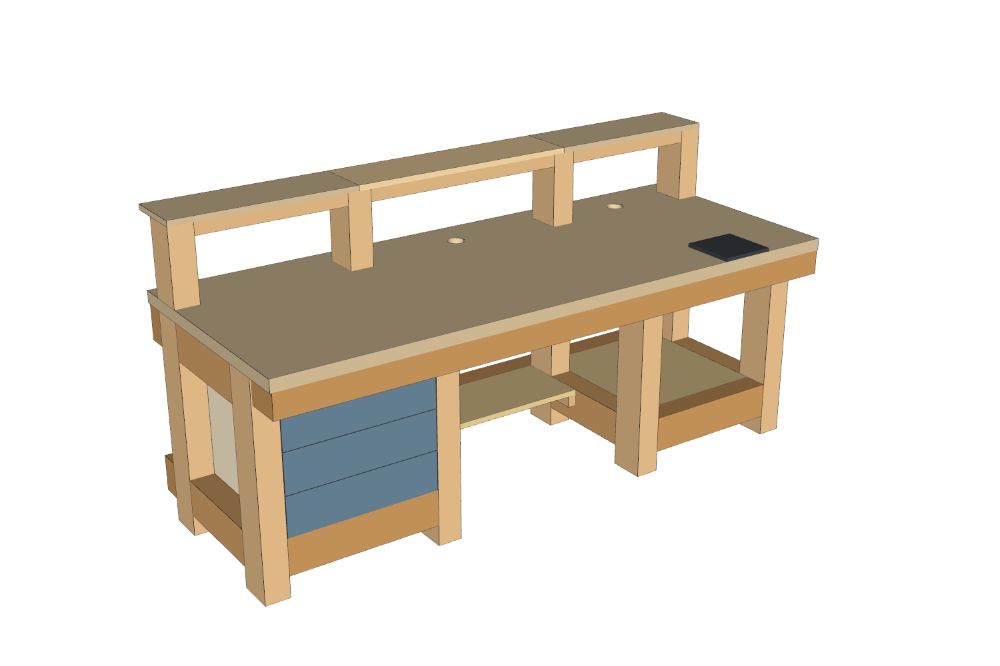

# Workbench – tavolo da lavoro modulare

Tavolo da lavoro 2000 × 800 mm, piano a 740 mm, per elettronica, computer e ricarica cartucce.
Il progetto è diviso in **tre moduli indipendenti**, ognuno con il proprio manuale, modello 3D e foglio costi:
si costruisce prima il tavolo base, gli altri si aggiungono quando vuoi.



| Modulo | Cosa comprende | Costo stimato | Cartella |
|---|---|---|---|
| **1 · Tavolo base** | Telaio in travi KVH 80×120 (5 barre da 4 m): 4 telai laterali uniti da 3 fasce a tutta lunghezza; piano lamellare 40, ripiani e rinforzo in OSB/3 18, zona ricarica con piastre intercambiabili, canaline | ~608 € | [moduli/1-tavolo-base](moduli/1-tavolo-base) |
| **2 · Cassettiera** | Cassettiera fissa a 3 cassetti per la campata sinistra | ~134 € | [moduli/2-cassettiera](moduli/2-cassettiera) |
| **3 · Alzatina** | 4 montanti + mensola 2000×200 in tavole lamellari 1000×200×18 con listello di rinforzo | ~42 € | [moduli/3-alzatina](moduli/3-alzatina) |

I prezzi sono stati verificati il 18/10/2026 sui siti di **Tecnomat, OBI e Leroy Merlin** (circa il 75% del totale); le poche voci non trovate a scaffale sono stime, evidenziate in giallo. Ogni voce dei fogli costi indica negozio e link. Il confronto completo tra i tre negozi, con il costo dei sistemi di giunzione alternativi, è in [confronto_prezzi_negozi.xlsx](confronto_prezzi_negozi.xlsx).

**Dove comprare:** quasi tutto da Tecnomat (unico con travi KVH 80×120 e lamellare 40; OSB e pannelli più economici; taglio in negozio). Da OBI viti M10 lunghe, spine Ø12 e staffe nervate. I dadi a tamburo M10 non li vende nessuno dei tre: ferramenta o online.

## Struttura del telaio

- **4 telai laterali**: gamba anteriore + gamba posteriore + traversa laterale alta e bassa, imbullonate (M10 + dado a tamburo + 2 spine Ø12).
- **3 fasce a tutta lunghezza (1990)** avvitate sulle facce delle gambe con 2 viti strutturali 8×160 per gamba: due posteriori di coltello (alta e bassa, contro il muro) e una anteriore alta posata di piatto, che lascia 620 mm liberi per le ginocchia.
- **Traverse basse anteriori** ACi e ARi nelle campate dei ripiani.
- Nessun giunto di testa tra due traverse sulla stessa gamba: ogni nodo si stringe da una testa accessibile.

## Come si collegano i moduli

- Il **tavolo base** prepara tutto: nelle 4 gambe posteriori c'è un foro Ø12 in testa e un dado a tamburo M10 (inserito dalla faccia laterale), e i 4 montanti dell'alzatina vengono tagliati dalle stesse 5 travi del telaio.
- La **cassettiera** non richiede lavorazioni sul telaio: si appoggia al ripiano OSB della campata sinistra, sotto la fascia anteriore, e si avvita alle gambe.
- L'**alzatina** si monta forando il piano in 4 punti e avvitando le barre M10 nei dadi già presenti nelle gambe.

## Contenuto di ogni modulo

- `*_manuale.pdf` – manuale passo passo: distinta materiali (BOM), viste quotate, taglio, foratura pezzo per pezzo, fasi di montaggio con immagini, controlli
- `*_costi.xlsx` – distinta e costi con formule
- `*.step` – modello 3D del modulo (FreeCAD, Fusion 360, SolidWorks)
- `immagini/` – viste di montaggio

Il tavolo base ha in più le tavole quotate (`tavolo_base_tavole.pdf`): pianta, prospetti, fianchi, schede di ogni traversa e delle fasce.
Il modello completo con tutti i moduli è in `modello/tavolo_completo.step`.

## Scelte di materiale

- **Travi KVH 80×120**: il prezzo al metro più basso tra quelle trovate, legno essiccato e stabile (confronto nel foglio costi del modulo 1).
- **OSB/3 18 per ripiani e rinforzo**: 27,50 € (Tecnomat), un solo pannello basta per tutto. Il lamellare 40 costerebbe 2,5 volte tanto; le tavole OBI 800×200×14 sarebbero ancora più care e più sottili.
- **Tavole lamellari 1000×200×18 per la mensola**: 4,50 € l'una (Tecnomat), più spesse ed economiche delle OBI 800×200×14; con il listello sotto il bordo anteriore la mensola è rigida anche su 78 cm di luce.

## Rigenerare i file

Gli script in `modello/` sono parametrici (Python + CadQuery). Da quella cartella:

```bash
pip install cadquery openpyxl matplotlib vtk
python tavolo_kvh.py          # modello completo, parts_kvh.json
python fori.py                # tutti i fori + controllo collisioni
python step_moduli.py         # un STEP per modulo
python costi.py               # confronto travi (confronto.json)
python costi_moduli.py        # i tre fogli costi
python manuale_render.py      # viste delle fasi di montaggio del tavolo base
python viste_base.py          # viste d'insieme del tavolo base
python dettaglio_fasce.py     # dettaglio del nodo gamba–traversa–fascia
python render_moduli.py       # viste di cassettiera e alzatina
python tavole_kvh.py          # tavole quotate del tavolo base
python manuale.py             # manuale del tavolo base
python manuale_cassettiera.py
python manuale_alzatina.py
```

I parametri (dimensioni, sezioni, campate, spessori) sono nel dizionario `P` di `tavolo_kvh.py`.
Gli script si aspettano le immagini nella stessa cartella in cui vengono eseguiti.

## Archivio

Versioni precedenti, non più in sviluppo:

- `archivio/quadrotti-8x8/` – prima versione in quadrotti di abete 8×8
- `archivio/listelli-25x50/` – versione in listelli 25×50 laminati
