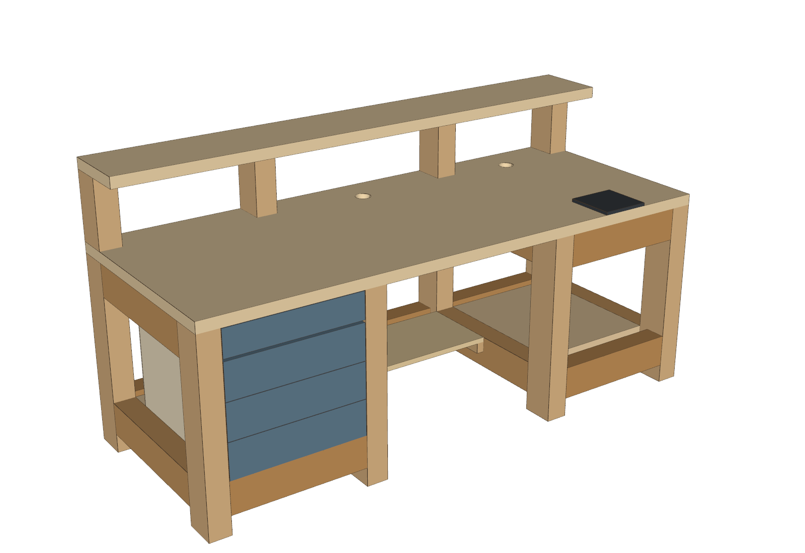

# Workbench – tavolo da lavoro

Tavolo da lavoro 2000 × 800 mm, piano a 740 mm, per elettronica, computer e ricarica cartucce.
Telaio in travi di abete **KVH 80×120** (C24, essiccato, piallato), piano in tavola lamellare 2000×800×40.



## Struttura

- 8 gambe, 3 campate nette: **cassetti** 500 (sinistra) · **seduta** 700 · **ricarica** 480 (destra)
- Ripiani bassi, mensola rialzata su 4 montanti, canaline passacavi sotto il bordo posteriore
- Cassettiera a 3 cassetti + cassetto appeso sotto il piano
- Zona ricarica con base per piastre intercambiabili (Rock Chucker, Dillon 550, morsa), piano raddoppiato e contropiastra in acciaio
- Nodi smontabili: bullone o barra M10 + dado a tamburo + 2 spine Ø12
- Tavolo da fissare a muro

## Documenti

| File | Contenuto |
|---|---|
| [docs/tavolo_manuale_lavorazione.pdf](docs/tavolo_manuale_lavorazione.pdf) | Manuale: ferramenta, codici pezzi, taglio, schemi di foratura di ogni pezzo, montaggio fase per fase, controlli finali |
| [docs/tavolo_kvh_tavole.pdf](docs/tavolo_kvh_tavole.pdf) | Tavole quotate: prospetti, schema di taglio, distinte |
| [docs/tavolo_costi.xlsx](docs/tavolo_costi.xlsx) | Confronto travi, distinta costi (celle gialle = stime da verificare), schema di taglio |
| [modello/tavolo_kvh.step](modello/tavolo_kvh.step) | Modello 3D (FreeCAD, Fusion 360, SolidWorks) |

## Materiale principale

- 4 travi KVH 80×120 da 4 m (29,90 € l'una), schema di taglio senza scorta
- 2 tavole lamellari abete 2000×800×40 (79 € l'una)
- Costo stimato complessivo: circa 820 € (dettaglio nel foglio costi)

## Rigenerare i file

Gli script in `modello/` sono parametrici (Python + CadQuery). Da quella cartella:

```bash
pip install cadquery openpyxl matplotlib
python tavolo_kvh.py        # modello, STEP, parts_kvh.json
python render.py kvh        # viste 3D
python fori.py              # tutti i fori + controllo collisioni
python costi.py             # foglio costi
python tavole_kvh.py        # tavole quotate
python manuale_render.py    # viste di montaggio
python manuale.py           # manuale di lavorazione
```

I parametri (dimensioni, sezione delle travi, campate) sono nel dizionario `P` di `tavolo_kvh.py`.
Gli script si aspettano le immagini nella stessa cartella in cui vengono eseguiti.

## Archivio

Versioni precedenti, non più in sviluppo:

- `archivio/quadrotti-8x8/` – prima versione in quadrotti di abete 8×8
- `archivio/listelli-25x50/` – versione in listelli 25×50 laminati con pannelli di irrigidimento
